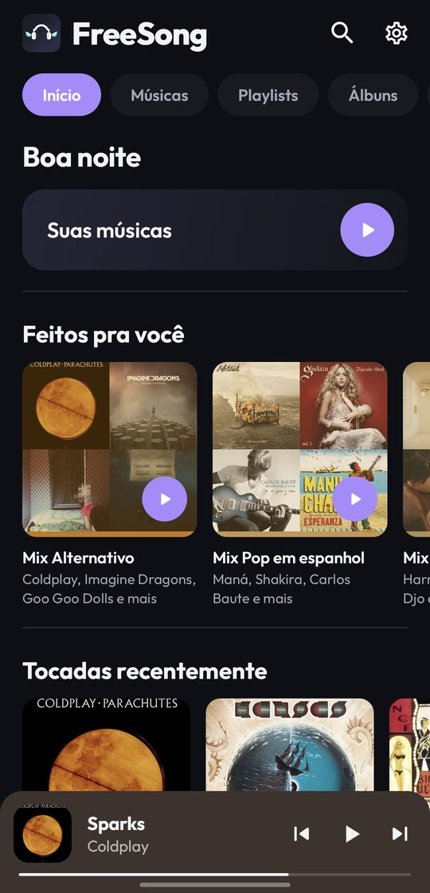
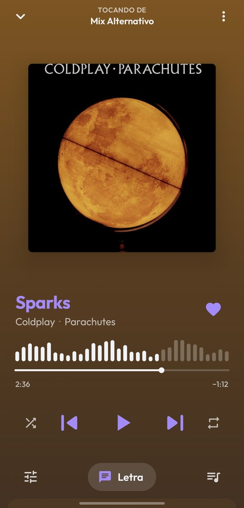
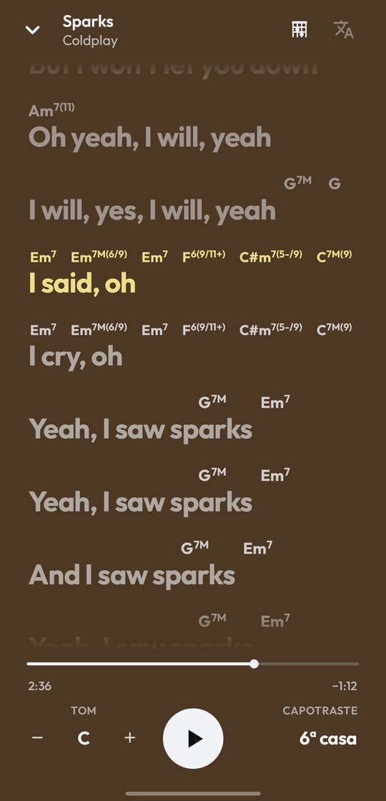
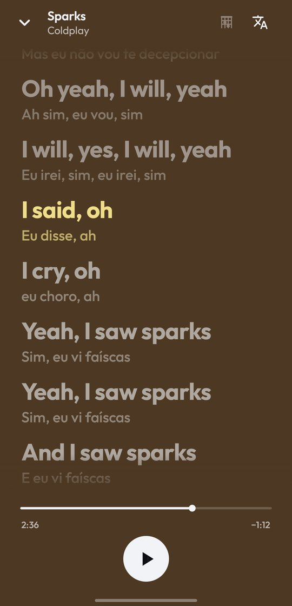
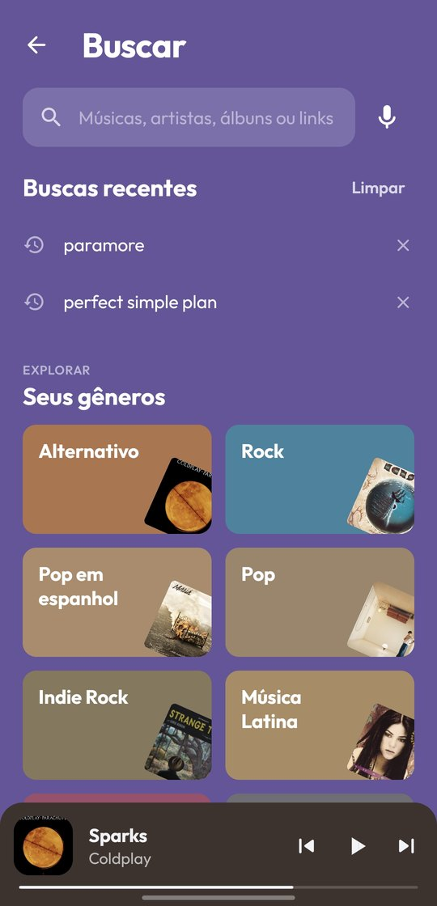
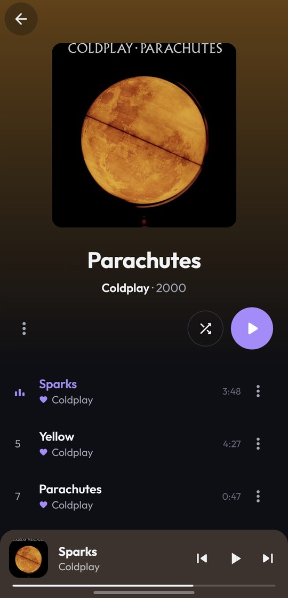
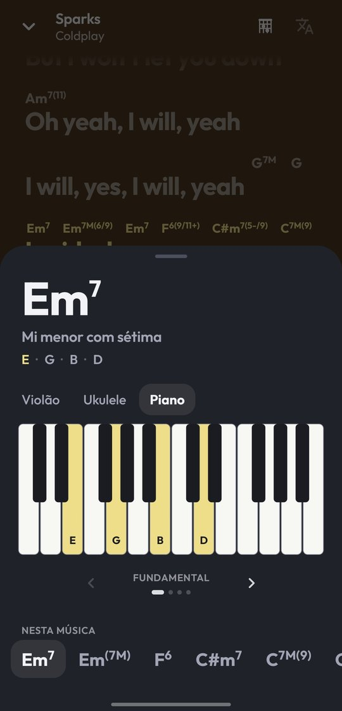
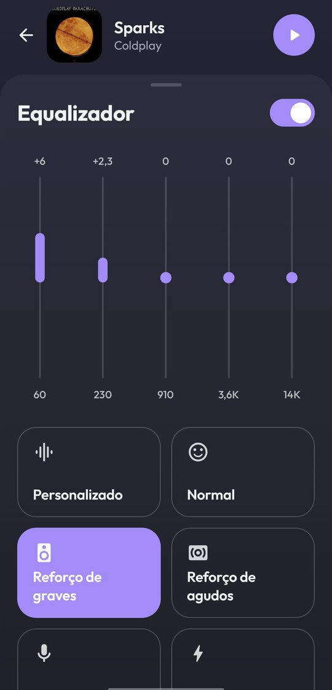

<div align="center">

# FreeSong

**Um player de música para Android sem conta, sem anúncio e sem assinatura.**

[**⬇ Baixar a APK**](../../releases/latest) · Android 8.0 ou mais novo

<br>

   

</div>

---

## Por que esse app existe

Ouvir música no celular virou uma escolha entre duas coisas ruins. Ou você paga uma assinatura
todo mês, ou aceita anúncio interrompendo a música, não pode pular faixa nem escolher o que toca
em seguida. E a biblioteca que você montou durante anos fica presa a uma conta: se a assinatura
acaba, ela vai junto.

Eu queria só um player bom. Abrir, procurar a música, tocar, montar as minhas playlists e ouvir
offline quando estiver sem internet, sem criar conta e sem ninguém registrando o que eu escuto.
Não achei um que fizesse isso do jeito que eu queria, então fiz o FreeSong.

É um projeto pessoal, aberto, para quem tem a mesma vontade.

## Como funciona

O FreeSong é um cliente: ele não hospeda nem distribui música. A busca e a reprodução usam o
catálogo público do YouTube Music por meio do [NewPipeExtractor](https://github.com/TeamNewPipe/NewPipeExtractor),
a mesma biblioteca do [NewPipe](https://newpipe.net). Todo o resto (biblioteca, playlists,
histórico, downloads e ajustes) fica no próprio celular, num banco de dados local.

Por cima disso o app junta algumas fontes abertas: a letra vem do [LRCLIB](https://lrclib.net),
o reconhecimento de música usa só a impressão digital do áudio, e os acordes vêm da cifra
quando ela existe ou são reconhecidos no próprio aparelho quando não existe.

## O que ele faz

- **Busca e toca** qualquer música na hora, sem precisar baixar. Quando a lista acaba, ele segue
  com músicas do mesmo estilo, como uma rádio.
- **Ouve offline**: baixe uma música ou deixe o "curtir" já baixar. Sem internet ou fora do
  Wi-Fi, o download espera na fila e começa sozinho depois.
- **Letra sincronizada**, com **tradução** verso a verso para músicas em outro idioma.
- **Acordes sobre a letra**, com transposição de tom, capotraste e o desenho do acorde para
  violão, ukulele e piano. Sem cifra disponível, o app reconhece os acordes ouvindo a música
  no próprio celular, e só quando você pede.
- **Clipe atrás da capa**, em loop e discreto. Um toque na capa abre o vídeo inteiro. Dá para
  desligar nos Ajustes.
- **Crossfade** entre as faixas e **equalizador**.
- **Reconhece a música que está tocando** no ambiente, pelo microfone.
- **Importa playlists e álbuns do Spotify** a partir do link público (ou compartilhando direto
  do app do Spotify).
- **Retrospectiva** todo janeiro: as músicas, artistas e horas que você mais ouviu no ano.
- **Economiza dados**: o que você já ouviu fica em cache no celular, e Ajustes › Armazenamento
  mostra o tamanho de cada cache para limpar quando quiser.

<div align="center">

   

</div>

## Como instalar

1. Baixe a APK mais recente em [**Releases**](../../releases/latest).
2. Abra o arquivo no celular e permita a instalação de fora da loja quando o Android pedir.

Não precisa de conta nem de e-mail. A partir da 1.13.0, o próprio app avisa quando sai uma versão
nova e se atualiza com um toque.

## Privacidade

Não há conta, rastreamento, anúncio nem servidor próprio. Biblioteca, histórico e ajustes ficam
no celular.

O app só acessa a internet para o que precisa, sempre por HTTPS:

| Para quê | Onde |
|---|---|
| Buscar e tocar músicas e clipes | YouTube Music (via NewPipeExtractor) |
| Letras | LRCLIB |
| Cifras | Cifra Club |
| Reconhecer a música do ambiente | Shazam (só a impressão digital do áudio, nunca a gravação) |
| Traduzir uma letra | Google Tradutor |
| Ler uma playlist pública que você importou | Spotify |
| Completar capa e dados do álbum | iTunes Search |
| Procurar e baixar versão nova do app | GitHub (Releases deste repositório) |

## Para desenvolvedores

Requisitos: **JDK 21** e **Android SDK** com a plataforma **37**. O Gradle baixa o resto.

```bash
git clone https://github.com/Villamediana/FreeSong.git
cd FreeSong
export ANDROID_HOME=$HOME/Android/Sdk   # ou um local.properties com sdk.dir=...

./gradlew :app:assembleDebug
# APK em app/build/outputs/apk/debug/app-debug.apk
```

A versão debug instala ao lado da normal (pacote `com.villamediana.sound.debug`).

Para gerar a release assinada com a sua chave, copie `keystore.properties.example` para
`keystore.properties`, aponte para a sua chave e rode `./gradlew :app:assembleRelease`. Chaves,
senhas e APKs ficam fora do repositório (`.gitignore`).

As versões oficiais saem por `tools/release.sh`, que compila, confere a assinatura e publica a APK
nos Releases; é de lá que o app instalado procura as atualizações.

Os testes rodam na JVM, sem emulador:

```bash
./gradlew :app:testDebugUnitTest                 # offline
SOUND_LIVE=1 ./gradlew :app:testDebugUnitTest    # inclui os testes que acessam a internet
```

Stack: Kotlin, Jetpack Compose, Media3 (ExoPlayer), Room, WorkManager, Coil, OkHttp e
NewPipeExtractor. A organização do código está em [`docs/ARCHITECTURE.md`](docs/ARCHITECTURE.md).

## Aviso

Projeto pessoal, sem fins lucrativos e sem relação com YouTube, Google, Spotify, Shazam,
Cifra Club ou qualquer gravadora. O FreeSong não hospeda conteúdo: ele reproduz o que já está
publicamente disponível nesses serviços. Cada pessoa é responsável pelo uso que faz do app e por
respeitar os termos dos serviços e as leis de direito autoral do seu país.

Se você gosta de um artista, apoie: vá ao show, compre o disco, siga e divulgue.

## Créditos

[NewPipeExtractor](https://github.com/TeamNewPipe/NewPipeExtractor) ·
[LRCLIB](https://lrclib.net) ·
[SongRec](https://github.com/marin-m/SongRec) e [ShazamIO](https://github.com/dotX12/ShazamIO) ·
[BTC](https://github.com/jayg996/BTC-ISMIR19) (reconhecimento de acordes, MIT) ·
[chords-db](https://github.com/tombatossals/chords-db) (MIT) ·
[Media3](https://developer.android.com/media/media3) ·
[Coil](https://coil-kt.github.io/coil/)
